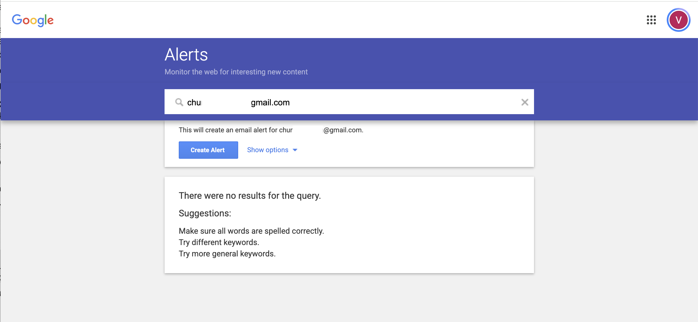
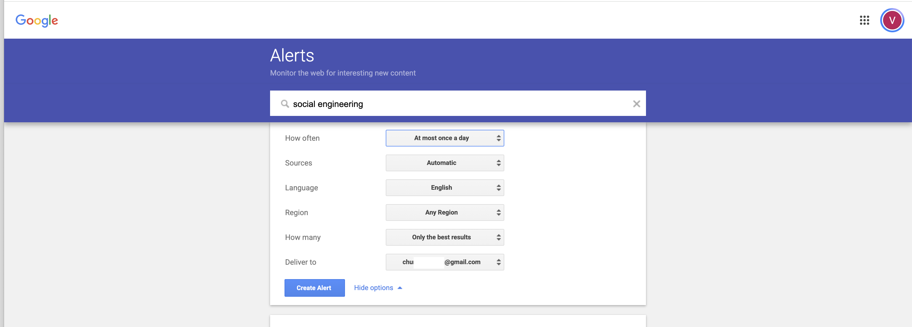
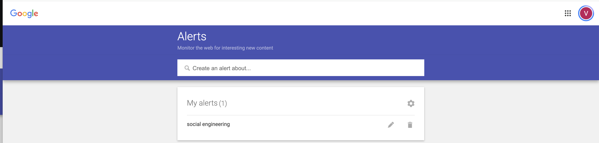
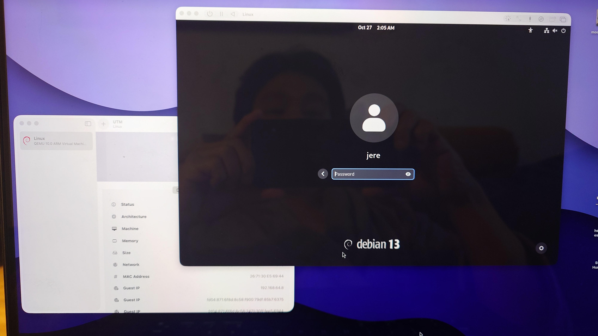

# h1 CyberScience

## Article

<b> Article name: </b> Educating and Raising Awareness on Cyber Security Social Engineering: A Literature Review 

<b>JUFO rating: </b> 1

    <b>Article URL: </b>
    <a href="https://www.researchgate.net/profile/Hussain-Aldawood/publication/330293734_Educating_and_Raising_Awareness_on_Cyber_Security_Social_Engineering_A_Literature_Review/links/5d9ae3c192851c2f70f21bf8/Educating-and-Raising-Awareness-on-Cyber-Security-Social-Engineering-A-Literature-Review.pdf" >Link</a>

## Review of Article
<ul>
    <li>
        
What are the key areas being researched?

        <ul>
            <li><b>Social engineering attacks:</b> The process and how cybercriminals manipulate others via human psychology, trust, and emotions to steal information or gain unauthorized access.</li>
            <li><b>Cybersecurity awareness and education:</b> The needed training that provides awareness while helps employees and individuals recognize threats such as phishing emails, fake websites, and online deception.</li>
            <li><b>Human factors in cybersecurity:</b> Idenitfying on how human error, lack of knowledge, and excessive trust can make people vulnerable to cyberattacks.</li>
            <li><b>Training methods:</b> The use of online learning, games, videos, self-paced courses, and simulated phishing exercises can improve cybersecurity awareness.</li>
            <li><b>Organizational security culture:</b> The process of how companies can combine employee education, security policies, and technical protections to reduce security risks.</li>
        </ul>
    </li>
    <li>
        
What's widely agreed upon?

        <ul>
            <li><b>People are an important element of cyber security:</b> By having the most robust technical defences in the world and still have security holes created by people.</li>
            <li><b>Education and awareness are vital:</b> The research cited in the article suggests that cybersecurity training can improve staff knowledge, attitudes and security related behaviour.</li>
            <li><b>Technical solutions on their own are not enough:</b> Technical controls are needed in place alongside clear policies and staff training.</li>
            <li><b>Continuous and engaging training is important:</b> Interactive learning, gamification and simulated phishing are training to train people to recognise and respond to threats.</li>
            <li><b>Everyone has a role in security:</b> An employee at any level in the organisation needs to understand their responsibilities in relation to the handling of sensitive information.</li>
        </ul>
    </li>  
    <li>
        
What are the open questions?

            <ul>
                <li><b>Which training methods work best?</b> More work is needed to establish which of the educational approaches actually leads to the most effective and sustainable improvements.</li>
                <li><b>Does awareness lead to real behavioral change?</b> Employees may well understand the cyber risks but still make mistakes in the real world.</li>
                <li><b>What factors influence employee behavior?</b> Further work could look at how individual differences, levels of trust, organisational culture and so on might impact vulnerability to attack.</li>
                <li><b>How can training effectiveness be measured accurately?</b> The authors advocate the use of experiments and case studies as a means of understanding actual behaviour rather than just relying on self reported answers.</li>
                <li><b>How can research become more comprehensive?</b> The review points out that its focus on English language publications and the limited number of books it covers may have meant that some relevant work was inadvertently left out. There is also a problem with the inconsistent use of the terms information security education, training and awareness.</li>
        </ul>
    </li>
</ul>

## Threat modeling quickrun: E-commerce Company

### 1. Company

- **Company:** VeryU Oy, a Finnish secondhand fashion e-commerce startup.
- **Crown jewels:** Customer personal data, seller accounts, product listings, payment-related information, company funds, reputation, and business continuity.

### 2. Bad Guys (Threat Actors)

- **Cybercriminals:** Want to steal customer data, take over accounts, or commit financial fraud.
- **Capability:** Moderate — can use phishing emails and stolen credentials.
- **Opportunity:** High — employees use email, online tools, and business accounts.
- **Intent:** Financial gain through fraud, data theft, or extortion.

### 3. Two Example Risks

| Risk | Likelihood | Financial Impact | Estimated Risk Value |
|---|---:|---:|---:|
| **1. Social engineering:** An employee receives a fake IT email, reveals login credentials, and an attacker accesses customer data. | 35% | €40,000 | **€14,000** |
| **2. Hacking:** An attacker exploits a vulnerability in the online store and steals customer information or disrupts operations. | 20% | €80,000 | **€16,000** |

*Calculation: Likelihood × financial impact = estimated risk value. These are illustrative annual estimates, not measured company data.*

### 4. Biggest Risk: Hacking

The hacking risk has the highest estimated value of **€16,000 per year**.

### 5. Risk Treatment — META

**Decision: Mitigate the risk.**

Preventative Actions:
- Apply security updates and fix known vulnerabilities.
- Require multi-factor authentication (MFA) for administrator accounts.
- Perform regular security reviews and maintain secure backups.
- Monitor suspicious activity and prepare an incident response plan.

## Voluntary

### Article alert for future thesis

I created a Google Alert that emails me new content about **social engineering**. It is a wide net to start with, so I can see what kind of articles show up before narrowing it down.

**Plan for narrowing the alert**

| Stage | Search term | Purpose |
|---|---|---|
| **Start (wide net)** | `social engineering` | Catch everything on the topic to see what kind of articles appear. |
| **After a couple of days** | `"social engineering" "security awareness" training` | Focus on awareness and training, the topic of the reviewed article. |
| **After a week** | `"phishing simulation" "security awareness training" employees` | Keep only articles that are directly useful for a possible thesis. |

## Install Linux on a virtual machine. Debian
Debian Linux has been installed via UTM virtualization 

